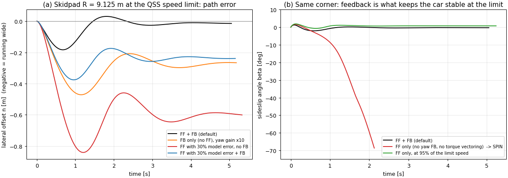
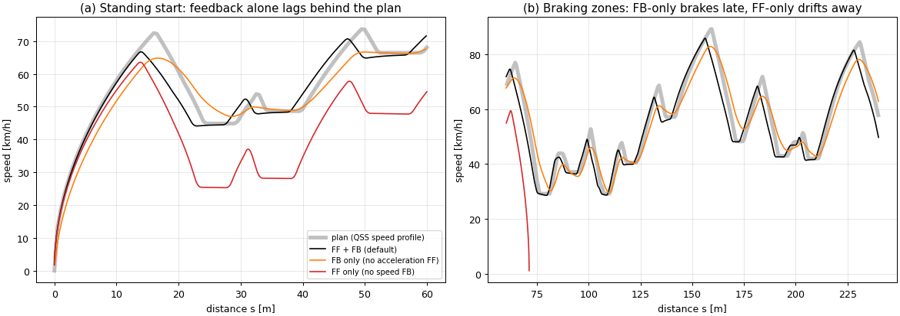

# Feedforward and Feedback in the Driver Model

This document explains, conceptually, the two halves of the driver/controller in [`fsae_lapsim/transient.py`](./fsae_lapsim/transient.py): **feedforward** and **feedback**.

It covers what each one is, why you need both, how they are used for steering and speed in this simulator, and what happens when you remove either one. That last part is shown with experiments run on the actual model.

Related documents:
- [TRANSIENT_DYNAMICS.md](./TRANSIENT_DYNAMICS.md): the vehicle physics.
- [TRANSIENT_CODE_WALKTHROUGH.md](./TRANSIENT_CODE_WALKTHROUGH.md): line by line through the code.

---

## Contents

1. [The short version](#1-the-short-version)
2. [The core idea](#2-the-core-idea)
3. [Why feedback alone is not enough](#3-why-feedback-alone-is-not-enough)
4. [Why feedforward alone is not enough](#4-why-feedforward-alone-is-not-enough)
5. [Putting them together](#5-putting-them-together)
6. [How this is done in the simulator](#6-how-this-is-done-in-the-simulator)
7. [Experiments: removing one or the other](#7-experiments-removing-one-or-the-other)
8. [How to think about it when tuning or extending](#8-how-to-think-about-it-when-tuning-or-extending)
9. [Glossary](#9-glossary)

---

## 1. The short version

> **Feedforward** answers *"what input should this need?"* It uses a **model** and the **plan**, and acts **before** any error exists.
>
> **Feedback** answers *"what went wrong, and how do I correct it?"* It uses a **measurement**, and acts only **after** an error appears.

| | Feedforward | Feedback |
|---|---|---|
| Uses | A model of the car + the reference (what you *want*) | A measurement (what *actually happened*) |
| Acts | Before the error: predictive | After the error: reactive |
| Good at | Doing the bulk of the work fast and without lag | Removing whatever the model got wrong; rejecting disturbances |
| Weak at | Model errors, disturbances, unstable dynamics, drift | Needs an error to act; lags; high gains cause oscillation |
| Can it destabilise the system? | No | Yes (gain too high, or too much delay) |
| Can it *stabilise* the system? | No | Yes |

In a well-designed controller, **feedforward does most of the work and feedback cleans up the rest**. In this simulator's steering, the feedforward supplies about 94–98% of the steer angle; the feedback supplies the last few percent and keeps the car stable at the limit.

---

## 2. The core idea

### The corner you can see coming

Think about how you drive into a corner on a road you know.

1. **Feedforward.** You see the corner, you know roughly how tight it is, and you turn the wheel by about the right amount as you arrive. You haven't measured any error yet. You are using your internal *model* of how the car responds to steering, together with the *plan* (the road ahead).
2. **Feedback.** Halfway round, you notice the car is drifting wide (perhaps the road is slippery, or you misjudged the radius), so you add a bit more steering. That correction is based on a *measured* error: the car is not where you wanted it.

A good driver does both together. A learner driver relies mostly on feedback: they react late, overcorrect, and weave. An expert relies mostly on feedforward, so their corrections are tiny.

### The shower

A feedback-only system is like adjusting an unfamiliar shower:
- You turn the knob, wait, feel the water (measurement), and it's too cold, so you turn it more.
- Because of the delay in the pipe, you overshoot: too hot.
- You turn it back, and so on.

The more aggressively you react (high gain), the worse the oscillation. Once you *know* the shower ("halfway gives about right"), you set it there straight away (feedforward) and only make small tweaks (feedback).

### In control-diagram terms

```
                         ┌──────────────┐
  reference r ──────────►│ feedforward  │──── u_ff ───┐
  (the plan)             │ (model⁻¹)    │             ▼
                         └──────────────┘          ┌─────┐       ┌───────┐
                                                   │  +  │──u───►│ plant │──► y (what happens)
           ┌───────────┐                           └─────┘       └───────┘     │
  r ──►(+)─│ feedback  │──── u_fb ───────────────────▲                           │
       ▲ − │  gain K   │                                                         │
       │   └───────────┘                                                         │
       └──────────────────────── measured y ◄────────────────────────────────────┘
```

- **The feedforward path never looks at the output.** It turns *what you want* into *what you should do*, using an (inverted) model of the plant.
- **The feedback path only looks at the error** e = r − y, and pushes in the direction that reduces it.

---

## 3. Why feedback alone is not enough

### Feedback needs an error to act

A proportional feedback controller outputs u = K·e. If the car needs a steady input u to hold a corner, feedback can only produce it if there is a steady error:

$$e = \frac{u_{\text{needed}}}{K}$$

**Example from this simulator: steering on the skidpad (R = 9.125 m) at the speed limit.**
- The car needs about **9.7°** (0.17 rad) of steer.
- With only the yaw-rate feedback term (gain 0.08 rad per rad/s), that requires a yaw-rate error of 0.17 / 0.08 ≈ **2.1 rad/s**.
- The *entire* target yaw rate is only 1.28 rad/s, so the feedback can never produce enough steer.
- The car runs wide and leaves the track within 16 m (§7.1).

### "So just raise the gain"

Raising K shrinks the steady error, but it has three costs:

1. **Oscillation and instability.** Every real system has some delay: here, tyre force build-up, yaw inertia and load transfer. High gain with delay means overshoot, then oscillation, then instability. That is the shower again.
2. **Saturation.** Large gains ask for more steering or torque than the actuator has, and the loop stops behaving linearly.
3. **Noise.** On a real car, sensor noise is multiplied by K and fed straight to the actuators.

In the experiment, 10× the yaw gain gets the car round the skidpad. It still runs **0.27 m wide** in steady state, and it oscillates more on the way there (§7.1).

### Feedback is always late

Feedback cannot react until the error has already happened. At a standing start, speed feedback only asks for force in proportion to how far behind the plan the car already is. So it accelerates late, and reaches 30 m **0.35 s later** than with feedforward (§7.2). The same lag shows up as braking too late before every corner.

---

## 4. Why feedforward alone is not enough

### The model is never perfect

Feedforward is only as good as its model.
- The steering feedforward here uses the *kinematic* bicycle model δ = atan(L/R). It knows nothing about tyre slip, so the car understeers a little more than predicted.
- With a deliberately wrong model (feedforward 30% too small), feedforward alone runs **0.60 m wide** on the skidpad and spins on the autocross (§7.1).

### Disturbances

Feedforward cannot see a bump, a gust, a patch of low grip or a cone-dodging correction. It only knows the plan.

### Drift

When the feedforward computes a *rate* (an acceleration) and the plant integrates it into a *state* (speed), every small error accumulates and nothing pulls it back.
- In the experiment, speed feedforward alone (acceleration commands, no speed correction) falls further and further behind the plan.
- Then, following the plan's braking points, it brakes to a **standstill 72 m into the lap** (§7.2).

### Feedforward cannot change stability

This point is easy to miss. Feedforward only *adds* an input signal. It does not change how the car responds to a disturbance, so if the car is unstable, feedforward cannot fix it.
- **At the grip limit, a car can be unstable in yaw:** the rear tyres saturate, and any extra slip angle produces *less* restoring force, not more.
- **In the experiment, feedforward-only steering spins the car** on the skidpad at the QSS limit speed, with sideslip passing 69° (§7.1).
- **Adding either feedback loop removes the spin:** yaw-rate steering feedback, or torque vectoring. So does slowing down by 5%.

**Feedback can change a system's dynamics. Feedforward cannot.**

---

## 5. Putting them together

### The division of labour

| Part | Job |
|---|---|
| **Feedforward** | Provide the input you *expect* to need: fast, no lag, using the model and the plan. |
| **Feedback** | Measure what feedforward got wrong and correct it; add damping and stability. |

Because feedforward has already done most of the work, the feedback only handles a small residual. So it can use a **modest gain**, which avoids the oscillation and noise problems of high gains.

### The one equation worth remembering

Take a simple static plant: the output equals the input times a gain, y = G·u. The feedforward uses a *model* of the plant, Ĝ, to compute u_ff = r/Ĝ, and the feedback adds K·(r − y). Solving for the remaining error gives:

$$\boxed{\;e = r - y = r\,\frac{1 - G/\hat G}{1 + G K}\;}$$

Read it term by term:
- **The numerator, (1 − G/Ĝ), is how wrong the feedforward's model is.**
  - With a perfect model (Ĝ = G), the error is **zero for any K**: feedforward alone would be perfect.
  - With no feedforward at all, the numerator becomes 1, so e = r/(1 + GK). That is pure feedback, and its error only shrinks by raising K.
- **The denominator, (1 + GK), is what feedback buys you:** whatever error feedforward leaves behind is divided by (1 + loop gain).

So **feedforward reduces the error that feedback has to deal with**, and **feedback attenuates whatever error is left**. Each one covers the other's weakness.

---

## 6. How this is done in the simulator

### 6.1 Steering: a cascade of two loops

The steering is built as **two nested loops**:

```
 OUTER LOOP (path, slow)                         INNER LOOP (yaw, fast)
 ─────────────────────────                       ──────────────────────────────────────────────────
                                                     feedforward:  δ_ff = atan(L · k_path)
 where am I vs the track?   ─► k_path ─► r_ref ─►                                          ─► δ ─► car
 (pure pursuit on n, ξ, s)      (curvature   = v·k   feedback:     δ_fb = k_yaw·(r_ref − r)
                                 to follow)          + torque vectoring: Mz = k_tv·Iz·(r_ref − r)
```

#### Outer loop: pure pursuit

[Lines 53–61](./fsae_lapsim/transient.py#L53) of `transient.py`.
- **What it does:** picks a target point on the centreline a short distance ahead, and computes the curvature `k_path` of the arc that would take the car there.
- **Why it is feedback:** `k_path` depends on where the car *actually is*. If the car has drifted wide or is pointing the wrong way, the target point sits further to the side and `k_path` gets larger. Pure pursuit is therefore a *position/heading feedback* loop, and its output is a curvature command.
- **Why it behaves like a feedforward:** the look-ahead point is placed using the *track ahead*. When the car is on the line in a constant-radius corner, `k_path` equals the track curvature exactly. So in normal running it delivers the plan, and it only deviates when there is an error.

#### Inner loop, feedforward: `δ_ff = atan(L · k_path)`

[Line 62](./fsae_lapsim/transient.py#L62), first term.
- **What it does:** converts "I want to follow curvature k" into "turn the wheels by this much".
- **How:** by inverting the **kinematic bicycle model**. A car with wheelbase L whose tyres don't slip follows radius R = L/tan δ.
- **What the model ignores:** tyre slip angles, load transfer and understeer.
- **Why it still works well:** at FSAE speeds the kinematic steer is most of the answer. In the worked example (R = 20 m at 15 m/s):

| Quantity | Value |
|---|---|
| Feedforward steer, atan(1.53/20) | 4.38° |
| Steer the car actually needs (from trim) | 4.66° |
| **Feedforward share** | **94%** |
| Left for feedback | 0.28° |

On the skidpad the share is even higher: 9.52° from feedforward against about 9.72° needed (98%).

#### Inner loop, feedback: `δ_fb = k_yaw · (r_ref − r)`

[Line 62](./fsae_lapsim/transient.py#L62), second term.
- **What it measures:** whether the car is actually rotating as fast as the path needs. `r_ref = v · k_path` is the yaw rate the car *should* have, and `r` is the measured yaw rate.
- **Too slow (understeer, or the yaw response still building):** it adds steer. **Too fast (oversteer, the start of a spin):** it removes steer.
- **What it corrects:** exactly the things the kinematic model ignores, without needing a model of them.
- **What it adds:** yaw *damping*. It resists rotation that doesn't match the path, which is why it stabilises the car at the limit.

#### Torque vectoring: a second feedback actuator on the same error

[Line 73](./fsae_lapsim/transient.py#L73): `Mz = k_tv · Iz · (r_ref − r)`.
- **Same error, different actuator.** It uses the same yaw-rate error but corrects it with a left/right torque difference instead of steering.
- **Pure feedback:** there is no feedforward yaw moment.
- **Effect:** it also adds yaw damping. The experiments show either it *or* the steering feedback alone is enough to prevent the spin at the limit.

### 6.2 Speed: feedforward from the plan, feedback on the error

[Line 71](./fsae_lapsim/transient.py#L71):

$$F_{req} = \underbrace{m\,a_{ref} + D + F_{rr}}_{\text{feedforward}} \;+\; \underbrace{m\,k_{speed}\,(v_{ref} - v)}_{\text{feedback}}$$

- **Feedforward: Newton's second law, inverted.**
  - The QSS plan says the car should accelerate at `a_ref` here, so the controller asks for exactly the force that would produce it.
  - It adds the drag D and rolling resistance F_rr it knows the car will have to overcome.
  - This happens before any speed error exists.
- **Feedback: proportional correction of the speed error.**
  - Default `k_speed` = 4 s⁻¹, so 1 m/s too slow asks for 280 × 4 = 1120 N extra.
  - It corrects for everything the plan's acceleration doesn't account for: tyre slip, load-transfer lag, the actuator limits in the vehicle model, and the accumulated error.
- **Look-ahead is a timing feedforward.** The reference is read 0.12 s *ahead* of the car (`speed_lookahead`). The force chain (motor → wheel slip → tyre force) takes time, so asking slightly early means the force arrives when the plan needs it. This compensates for a *known* delay before it causes an error.

### 6.3 Summary of every piece

| Piece | Code | Type | Uses |
|---|---|---|---|
| Pure-pursuit curvature `k_path` | L55–60 | Feedback (position/heading), placed using the track ahead | Measured s, n, ξ + track geometry |
| Kinematic steer `atan(L·k_path)` | L62 | **Feedforward** (model inversion) | Kinematic bicycle model |
| Yaw-rate steer `k_yaw·(r_ref − r)` | L62 | **Feedback** | Measured yaw rate |
| Torque vectoring `k_tv·Iz·(r_ref − r)` | L73 | **Feedback** | Measured yaw rate |
| Planned acceleration `m·a_ref` | L71 | **Feedforward** | QSS plan + Newton's law |
| Drag + rolling resistance | L69–71 | **Feedforward** (disturbance cancellation) | Aero and rolling models |
| Speed correction `m·k_speed·(v_ref − v)` | L71 | **Feedback** | Measured speed |
| Reference look-ahead `s + v·t_look` | L66 | **Feedforward** (delay compensation) | Known actuation delay |
| Traction control | L102–115 | **Feedback** | Measured slip ratio |

---

## 7. Experiments: removing one or the other

These runs use the default car. A test script disabled one part of the controller at a time; the production code is unchanged.
- **"FF 30% model error"** multiplies the kinematic feedforward steer by 0.7, to stand in for a poor model.
- **"Status"** is the simulator's own verdict. A spin trips the heading-error check.

### 7.1 Steering



**Skidpad, R = 9.125 m, at the QSS speed limit.** Kinematic steer is 9.52°.

| Controller | Status | Steady-state offset n | Max \|n\| | Lap |
|---|---|---|---|---|
| **FF + FB (default)** | ok | **−0.02 m** | 0.18 m | 5.05 s |
| FB only (no FF), default gain | ran wide, left the track at 16 m | – | > 2 m | – |
| FB only (no FF), 10× yaw gain | ok | −0.27 m | 0.47 m | 5.18 s |
| FF only (no yaw FB, no torque vectoring) | **spun** at 22 m (β → 69°) | – | – | – |
| FF only, at 95% of the limit speed | ok | – | – | – |
| FF with 30% model error, no FB | ok | −0.60 m | 0.84 m | 5.33 s |
| FF with 30% model error + FB | ok | −0.24 m | 0.38 m | 5.15 s |

Isolating which feedback prevents the spin (100% speed):

| Yaw-rate steer FB | Torque vectoring | Result |
|---|---|---|
| on | on | ok (default) |
| off | on | ok, max sideslip 2.2° |
| on | off | ok, max sideslip 9.0° |
| off | off | **spin** |

**2024 autocross (878 m).**

| Controller | Status | Lap | Max \|n\| |
|---|---|---|---|
| **FF + FB (default)** | ok | **60.41 s** | **0.68 m** |
| FB only, default gain | left the track at 86 m | – | – |
| FB only, 10× yaw gain | ok | 60.65 s | 1.21 m |
| FF only (no yaw FB, no TV) | spun at 339 m | – | – |
| FF only, 95% speed | ok | 63.12 s | 0.54 m |
| FF only, 90% speed | ok | 66.27 s | 0.50 m |
| FF + FB, 90% speed | ok | 66.19 s | 0.52 m |
| FF 30% low, no FB | spun at 103 m | – | – |
| FF 30% low + FB | ok | 60.92 s | 0.90 m |

**What these show:**

1. **Feedback alone fails, for the reason in §3.** With a sensible gain it can't produce the steer a corner needs without a huge error, so the car runs wide. With a 10× gain it gets round, but the path error is roughly double, the response is more oscillatory (orange curve in figure a), and it still settles 0.27 m wide.
2. **Feedforward alone works well below the limit.** At 90% speed it is within 0.1 s of the full controller. Away from the limit the car is stable and the kinematic model is good, so there is little for feedback to do.
3. **At the limit, feedforward alone spins the car** (figure b). The near-saturated rear tyres make the yaw motion unstable, and no amount of open-loop steering fixes that. Either feedback loop, steering or torque vectoring, adds the damping that holds it.
4. **With a bad model, feedback recovers most of the loss.** Feedforward that is 30% too small runs 0.60 m wide by itself; feedback cuts that to 0.24 m and turns a spin on the autocross into a finished lap. The 0.24 m that remains is the steady error of a *proportional* controller (§3): the offset is what generates the corrective steer.

### 7.2 Speed



**2024 autocross:**

| Controller | Status | Lap | RMS speed error vs plan | Max over-speed vs plan | Time to 30 m |
|---|---|---|---|---|---|
| **FF + FB (default)** | ok | 60.41 s | **0.59 m/s** | **0.15 m/s** | **2.58 s** |
| FB only (no `a_ref`) | ok | 59.44 s | 1.85 m/s | 5.97 m/s | 2.93 s |
| FB only, 3× `k_speed` | ok | 59.34 s | 0.89 m/s | 2.01 m/s | – |
| FF only (`k_speed` = 0) | **stopped** at 72 m | – | 5.36 m/s | – | – |
| *(QSS plan itself)* | | *59.94 s* | | | *2.54 s* |

**What these show:**

1. **Feedback-only lags (figure a).** It only pushes when it is already behind, so it accelerates late off the line (0.35 s lost by 30 m) and brakes late into every corner (figure b, orange). Tripling the gain reduces the lag but doesn't remove it.
2. **Feedforward-only drifts.** Each small shortfall in achieved acceleration accumulates into a speed error that nothing corrects. The plan's braking points then take the already-slow car down to a standstill.
3. **A faster lap time is not automatically a better controller.**
   - The feedback-only runs finish *faster* than the QSS plan (59.4 s vs 59.9 s). They do it by **not following the plan**: up to 6 m/s faster than planned into braking zones, with larger path errors.
   - That only works because pure pursuit's look-ahead smooths the slaloms, so the car isn't held exactly to the centreline that QSS assumed.
   - On a real coned course, braking 6 m/s late is how you hit cones.
   - The point of the transient simulation is to test whether the car can **execute the plan**; the default controller does that to within 0.6 m/s RMS.

---

## 8. How to think about it when tuning or extending

### A design order that works

1. **Get the feedforward right first.**
   - Ask: *"If the model were perfect, what input would produce exactly the plan?"*
   - Implement that (model inversion), and test it with feedback turned off, below the limit. It should already be close.
2. **Add the least feedback that gives the required accuracy and stability.**
   - Start with low gains and raise them until the residual error is acceptable.
   - Stop well before oscillation starts.
3. **Check at the limit.** Stability problems only appear there, and that is where feedback earns its keep.

### Reading the symptoms

| Symptom | Usually means | Fix |
|---|---|---|
| Steady offset in long corners | Feedforward model wrong (e.g. understeer not included), and proportional FB can't remove it completely | Improve the FF (below), or add a small **integral** term on the error |
| Late reaction everywhere, path or speed lagging the plan | Missing or too-small feedforward; the loop is relying on feedback | Add/fix FF; add look-ahead |
| Oscillation, weaving, hunting | Feedback gain too high for the delays in the loop | Reduce gain; lengthen pure-pursuit preview |
| Spins or snaps at the limit | Not enough yaw damping, i.e. too little feedback on yaw | Raise `k_yaw` or `k_tv` moderately; or reduce speed scale |
| Slow drift away from the plan | Feedforward-dominant loop with too little feedback | Raise the FB gain |

### Improving the feedforward in this simulator

- **Understeer-aware steer.** Use the steady-state cornering relation instead of the kinematic one:

  $$\delta_{ff} = \frac{L}{R} + K_{us}\,a_y \qquad (a_y = v^2/R)$$

  K_us is the understeer gradient. It is computed in the Vehicle tab's derived quantities, or can be fitted from trims at several lateral accelerations. This would cancel most of the residual that feedback currently corrects, and shrink the steady offset.
- **Use the track curvature directly** for the feedforward, κ(s + preview), instead of the pure-pursuit curvature. That separates the "plan" part from the "correction" part more cleanly.
- **Yaw-moment feedforward for torque vectoring.** Command the yaw moment needed for a change in yaw rate (I_z·ṙ_ref) rather than waiting for an error.

### Improving the feedback

- **Integral action** on the yaw-rate or path error removes the steady offset. It needs anti-windup, because the actuators saturate at the limit.
- **Gain scheduling.** The yaw dynamics change a lot with speed, so use gains that vary with speed.
- **LQR on the linearised model.** The State-space tab exports A and B; LQR then gives feedback gains that are optimal for that operating point, with guaranteed stability margins.

---

## 9. Glossary

| Term | Meaning |
|---|---|
| **Reference / plan** | What you want the system to do: here, the centreline and the QSS speed profile. |
| **Plant** | The thing being controlled: here, the 15-state vehicle model. |
| **Feedforward (open loop)** | Input computed from the reference and a model, without measuring the output. |
| **Feedback (closed loop)** | Input computed from the measured error between reference and output. |
| **Model inversion** | Running a model "backwards": from desired output to required input. E.g. desired radius → steer, desired acceleration → force. |
| **Gain** | How strongly feedback reacts to error (e.g. `k_yaw`, `k_speed`, `k_tv`). |
| **Steady-state error** | The error left once everything has settled. Non-zero for proportional-only feedback whenever the feedforward is imperfect. |
| **Proportional / integral** | Proportional output ∝ current error. Integral output ∝ accumulated error, which removes steady-state error but can overshoot. |
| **Cascade control** | Nested loops: a slow outer loop (path) gives the reference for a fast inner loop (yaw). |
| **Damping** | Resistance to oscillation. Feedback on a rate (like yaw rate) adds damping. |
| **Saturation** | An actuator at its limit (steer lock, motor torque, tyre grip). Feedback can't push harder than this. |
| **Look-ahead / preview** | Using the reference slightly in the future to compensate for known delays; a feedforward technique. |
